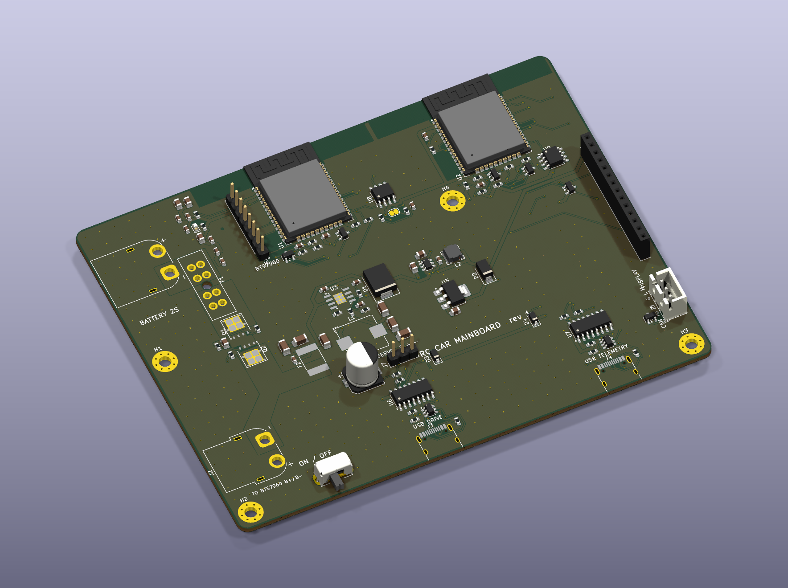

# RC Car Mainboard

One board that replaces the wiring nest: both ESP32s, CAN, power, and every connector the car needs. The Raspberry Pi stays on its own board and joins over the CAN connector.



| | |
|---|---|
| Size | **130 × 100 mm** (5.1 × 3.9 in), 3 mm corner radius |
| Layers | 2, 1.6 mm FR-4 |
| Copper | 2 oz recommended (battery → motor path carries motor current) |
| Smallest features | 0.15 mm traces, 0.2 mm holes (PCBWay standard process) |

## What's on it

| Block | Parts |
|-------|-------|
| Power input | XT60 battery in, 30 A blade fuse, reverse-polarity MOSFET, soft on/off switch (MOSFET + edge slide switch), XT60 out to the BTS7960 |
| Servo supply | TPS54560B, 5 V / 5 A, own polyfuse |
| Logic supply | AP63205 5 V buck, OR-ed with both USB ports, AMS1117 3.3 V |
| Drive ESP32 | ESP32-WROOM-32E, USB-C + CH340C with auto-program, servo header, 8-pin BTS7960 header |
| Telemetry ESP32 | ESP32-WROOM-32E, USB-C + CH340C, battery voltage divider, 14-pin display socket |
| CAN | Two SN65HVD230 on board, split 120 Ω termination (cut JP1 to disable), TVS protection, JST-XH to the Pi |

### Connectors

| Ref | Connector | Goes to |
|-----|-----------|---------|
| J1 | XT60 male | 2S LiPo |
| J2 | XT60 female | BTS7960 B+ / B− |
| SW1 | Slide switch (board edge) | Turns the whole car on and off |
| J6 | 1×8 header, 2.54 mm | BTS7960 control header, pin for pin (straight ribbon) |
| J7 | 1×3 header, 2.54 mm | Steering servo (S, +, −) |
| J8 | 1×14 socket, 2.54 mm | 3.5" ILI9488 display, pin for pin |
| J5 | JST-XH 3-pin | CAN to the Raspberry Pi (H, L, GND) |
| J3 / J4 | USB-C | Flash / power the drive / telemetry ESP32 |

## Ordering from PCBWay

Upload `fab/rc_mainboard_gerbers.zip` at pcbway.com → PCB Instant Quote → Quick-order PCB. Settings:

| Option | Value |
|--------|-------|
| Layers | 2 |
| Size | 130 × 100 mm |
| Thickness | 1.6 mm |
| Min track / spacing | 6/6 mil (0.15 mm) |
| Min hole | 0.2 mm |
| Outer copper | **2 oz** |
| Surface finish | HASL lead-free (or ENIG) |

**Assembly (optional):** choose PCB Assembly and upload `fab/rc_mainboard_bom.csv` and `fab/rc_mainboard_centroid.csv` with the Gerbers. The BOM lists a manufacturer part number for every IC, so PCBWay can source them. Through-hole parts (XT60s, fuse holder, switch, headers) are marked THT; they're easy to hand-solder if you'd rather save on assembly.

The ESP32 modules ship blank. Flash each one over its own USB-C port; pick the role in `idf.py menuconfig` (drive on the board marked USB DRIVE, telemetry on USB TELEMETRY).

## Before you power it up

1. Inspect the battery path (J1 → F1 → Q1 → Q2 → J2) for solder bridges.
2. Plug in USB only first: the green power LED should light and both ESP32s should enumerate.
3. Then connect the battery with SW1 off, and turn SW1 on.
4. Check the servo rail (J7 pin 2) reads about 5.0 V before plugging the servo in.

## Design notes

- **Servo supply compensation** uses values for a 5 V / 5 A output at ~490 kHz. They're a reasonable starting point; confirm with TI's WEBENCH or the TPS54560B datasheet before ordering a large batch.
- **Antennas** overhang the top edge with a copper keep-out underneath; mount the board so nothing metal sits right above them.
- **Display backlight** is switched by Q7: IO32 low = on (the firmware does this).
- **Touch panel** is wired (SPI shared with the display, IO14 CS, IO35 IRQ) but the firmware doesn't use it yet.

## Regenerating

Everything is generated from [`generator/design.py`](generator/design.py), one list of every part and connection. Edit that, not the KiCad files.

```bash
cd PCB/generator
python gen_sch.py                      # schematic
<kicad>/bin/python.exe route.py        # board + autoroute (needs Freerouting + Java 25)
<kicad>/bin/python.exe export.py       # PCBWay files + renders
```

`<kicad>` is the KiCad 10 install folder; `route.py` reads `FREEROUTING_JAR` and `JAVA` from the environment.
